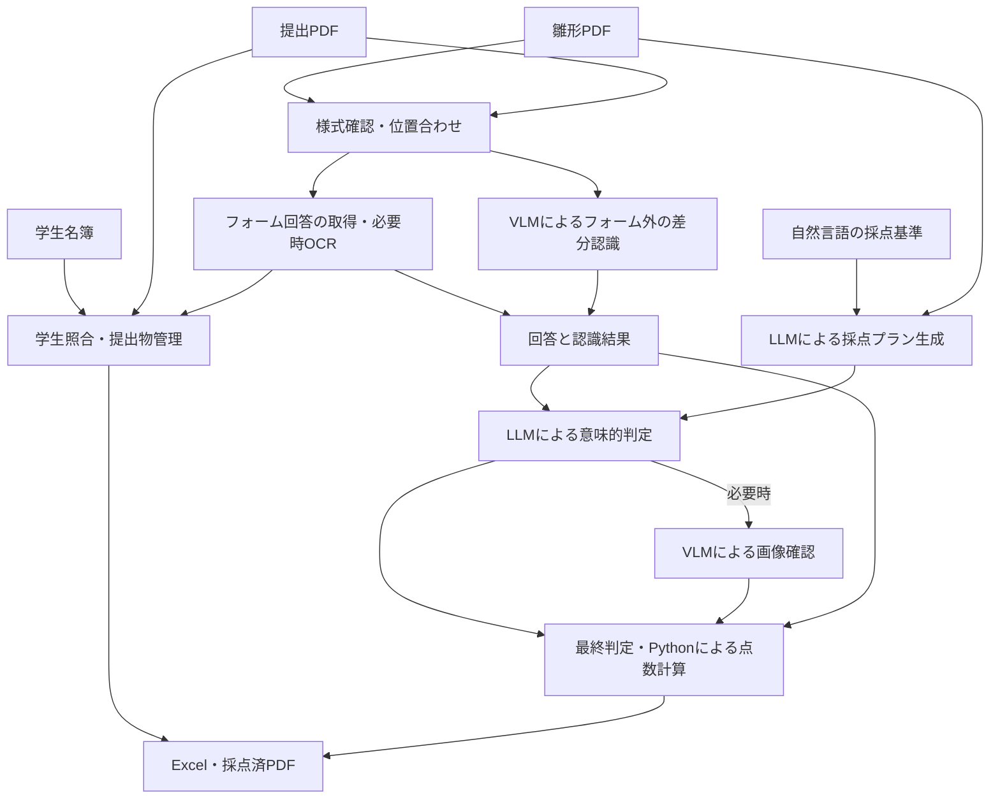

# PDF Report Grader

共通の雛形PDFを使用する演習・実験レポートのためのAI採点支援ツールです．提出PDFを受講者名簿と照合し，回答内容と提出状況を集計し，自然言語で指定した採点基準に従って暫定的なAI採点を行います．結果はExcelと採点理由付きPDFで確認できます．CLIとローカルWebUIに対応します．

## 特徴

- **フォームを保持したPDFと，フォームが失われたPDFの両方に対応**：正常なPDFフォームは直接読み取り，印刷・平坦化・画像化されたPDFは雛形との位置合わせと文字認識によって回答の復元を試みます．
- **雛形との差分に基づく視覚的な認識**：フォーム外の写真，スクリーンショット，手書き文字，波形，図形などをVLMでページごとに網羅的に認識します．教員が個々の写真欄や描画領域の座標を指定する必要はありません．
- **自然言語による採点基準**：教員の記述からLLMが採点プランを生成します．課題ごとに採点プログラムを書く必要はありません．
- **LLM・VLM・Pythonの役割分担**：LLMは意味的判定，VLMは視覚情報の認識と必要に応じた画像判定，Pythonは照合・形式検証・数値計算を担当します．AIによる減点候補は独立した再検証を行います．
- **認識と採点の分離**：認識結果をキャッシュし，採点基準を変更した場合も有効な認識結果を再利用します．
- **提出物の管理と返却支援**：名簿照合，PDFの改名・振り分け，Excel出力，フォームを保持した採点済PDFの生成を一括処理します．WebUIでは処理中のPDFを確認できます．
- **ローカルAI対応**：OpenAI互換APIを備えたLLM・VLMサーバを指定できます．両サーバを管理下の環境で運用すれば，学生の提出物を外部AIサービスへ送信せずに処理できます．

### 処理の概要



フォーム外認識は採点プランに依存しません．画像認識の段階では採点せず，雛形から追加された位置・種類・内容を記述します．AI採点は暫定評価であり，教員が最終確認します．AIを使わず提出物の整理・集計だけを行うこともできます．

## 1．セットアップ

Python 3.11以降が必要です．

```bash
python3 -m venv .venv
source .venv/bin/activate
pip install -r requirements.txt
cp -n examples/config.example.toml config.toml
mkdir -p in out
```

既存の `config.toml` は上書きしないでください．

## 2．入力ファイル

入力ファイルは `in/` に置きます．以下はクラスごとに提出ZIPを管理する例です．

```text
in/
├── kadai_w01.pdf
├── grading_w01.txt
├── 2CC1.xlsx
└── 2CC1/
    └── DATA_w01_20261126.zip
```

| ファイル | 内容 |
|---|---|
| 雛形PDF | 回答用フォームを含む未記入のPDF |
| 提出ZIP | 学生が提出したPDF群（展開済みフォルダも可） |
| 名簿XLSX | 受講者名簿 |
| 採点基準TXT | 自然言語で記述した採点基準（AI採点時のみ） |

### 雛形PDF

学生情報欄には次のフォーム名（フィールドID）を使用します．

| フィールドID | 内容 |
|---|---|
| `stu_id` | 学籍番号 |
| `stu_class` | クラス |
| `stu_num` | 名列番号 |
| `stu_name` | 氏名 |

課題の回答フォーム名は任意です．回答欄ごとに識別できる名前を付けてください．写真欄や波形図など，フォーム外の回答領域について個別の座標設定は不要です．雛形にはフォームが必要ですが，提出PDF側のフォームは失われていても復元を試みます．

### 提出PDFのファイル名

**学籍番号がファイル名に含まれていることを推奨します．** 特定のLMS固有の長いファイル名である必要はありません．同梱の設定例の正規表現は独立した7桁の学籍番号，または `20` で始まる4桁の年と7桁の学籍番号を連結した形式に対応します．例えば `1234567.pdf`，`report_w05_1234567.pdf`，`2CC1-001_20261234567.pdf` から学籍番号 `1234567` を抽出できます．

抽出規則は設定ファイルで変更できます（`filename_patterns` は必須です）．異なる学籍番号体系やLMSを利用する場合は `[matching].filename_patterns` を調整してください．各正規表現には名簿上の学籍番号を抽出するキャプチャグループを1個だけ指定します．設定例：

```toml
[matching]
filename_patterns = [
    '(?<![0-9])([0-9]{7})(?![0-9])',
    '(?<![0-9])20[0-9]{2}([0-9]{7})(?![0-9])',
]
```

ファイル名から一意に照合できない場合のうち，候補がない場合はPDF内の学籍番号・氏名を利用します．複数学生が候補となる場合は自動確定しません．フォームの消失や学生情報の誤入力に備え，元の提出ファイル名はできるだけ維持してください．

### 学生名簿

XLSXの第1シートの第1行には，`受講名列番号`，`学籍番号`，`所属クラス`，`学生氏名` の4列が必要です（順序は任意）．学籍番号は先頭ゼロの消失を避けるため文字列として保存することを推奨します．現版の名簿ヘッダとWebUIの課題検出規則は固定です．別の名簿形式を使う場合は入力ファイルを変換してください．

## 3．設定

`config.toml` を編集します．出力先を `out/` にする場合は，既存の `[output]` セクションを次のように設定します（なければ追加）．

```toml
[output]
directory = "out"
```

AIを利用する場合は，既存の `[vlm]` と `[grading]` セクション内の次の項目を設定します．以下は抜粋です．URLとモデル名は使用するOpenAI互換サーバに合わせて変更してください．

```toml
[vlm]
enabled = true
base_url = "http://localhost:8000/v1"
model = "YOUR_VLM_MODEL"
api_key = ""

[grading]
base_url = "http://localhost:8000/v1"
model = "YOUR_LLM_MODEL"
api_key = ""
visual_mode = "auto"
```

AI採点では，LLM/VLMに必須の写真・スクリーンショット・描き込み等の存在を確認できる根拠を求めます．Pythonは応答形式と点数計算を担当し，自然言語のキーワード照合による判定の変更は行いません．`visual_mode = "auto"` では根拠不足の項目を画像で再確認し，それでも判定できなければREVIEW（要確認）とします．未判定の減点は適用しないため，満点の暫定点が表示される場合もありますが，「減点なし」の確定結果とは区別されます．

### VLMの認識品質

次の設定はフォーム外の細かな描き込みや複数の追加箇所の認識に関係します．既存の `[vlm]` セクションに追記・変更します．

```toml
# [vlm] 内の設定
dpi = 200
description_dpi = 150
description_max_chars = 1000
max_tokens = 2048
grading_max_tokens = 4096
```

`description_dpi` は `dpi` 以下に設定します．`description_max_chars` はページ説明の文字数上限，`max_tokens` は通常の認識・OCRの生成トークン上限，`grading_max_tokens` は画像採点・再検証の生成トークン上限です．既存設定で100dpiや300文字などを指定している場合は明示的に更新してください．生成上限や応答形式のエラーが頻発する場合はログを確認して調整します．

APIキーは `VLM_API_KEY`，`GRADING_API_KEY` 環境変数でも指定できます．AIを使わず集計するだけなら `[vlm]` の `enabled = false` とし，採点基準を指定しません．設定の詳細は [INTERNAL.md](INTERNAL.md) を参照してください．

## 4．WebUIでの実行

CLIと同じ `config.toml` およびキャッシュを使います．

```bash
.venv/bin/python webui.py
```

ブラウザで `http://127.0.0.1:7860/` が開きます．クラスと課題を選択し，必要なら採点基準を編集して処理開始を押します．課題一覧はクラス名・課題番号順に表示し，複数課題は表示順に処理します．採点プランは自動管理します．採点前に確認したい場合は「採点プラン確認・生成」を押し，結果欄の「プラン」で内容を確認できます．

- 自動検出の規則：`in/<クラス>.xlsx`，`in/<クラス>/DATA_wXX_*.zip`，`in/kadai_wXX.pdf`，`in/grading_wXX.txt`．元ZIPがない場合は `out/<クラス>/DATA_wXX_*/` の処理済みフォルダも対象です．
- 結果ボタンはローカルLinuxの `xdg-open` で開きます．ブラウザを閉じてもWebUIサーバを停止しなければ処理は継続します．中断した場合は途中のファイルが残ることがあります．
- ポート変更は `--port 7861`，自動ブラウザ起動の無効化は `--no-browser` を指定します．ローカル専用であり，外部に公開しないでください．同時にCLIや別のWebUIから同じ結果フォルダを処理しないでください．

処理中はログの右側に元の提出PDFを縮小表示します．「ページ追従」で解析中のページに切り替わり，前・次ボタンで手動選択できます．PDFをクリックするか「拡大」を押すと拡大表示します．プレビュー欄の左端をドラッグして幅を変更できます．不要なら「PDFプレビュー」のチェックを外してください．複数ページをまとめて画像判定する場合は最後に準備したページが表示されます．処理終了時は表示を消去します．

## 5．CLIでの実行

プロジェクトのルートディレクトリから実行します．CLIの入口は `grade_reports.py` です．

### 通常の集計

```bash
.venv/bin/python grade_reports.py \
    in/kadai_w01.pdf in/2CC1/DATA_w01_20261126.zip in/2CC1.xlsx \
    --output-dir out/2CC1
```

### AI採点を含む集計

採点基準をUTF-8のテキストで作成します．数値の正誤や許容誤差，文章の意味的な正誤，図・波形，写真の有無，文字数などを自然言語で指定できます．以下は架空の組込みシステム演習を想定した例です（[examples/grading-example.txt](examples/grading-example.txt)）．実際に使用する雛形PDFに合わせて課題番号と採点条件を変更してください．

```text
レポートは10点満点とする．
提出者には最低1点を与え，無関係なPDFの提出は1点，未提出は0点とする．
(1) 課題1の回答が100msと等価でなければ1点減点する．単位換算や表記の違い（100ミリ秒，0.1秒など）は許容する．単位のない回答は，雛形で単位が指定されている場合のみ許容する．
(2) 課題2の測定値が3.3Vの±5%（3.135V以上3.465V以下）の範囲外，または未記入であれば1点減点する．等価な単位表記は許容する．
(3) 課題3の説明に，static変数が関数呼び出しの間で値を保持することへの言及がなければ2点減点する．表現の違いは許容する．
(4) 課題4のタイムチャートに描き込みがなければ2点減点する．描き込みがある場合，周期が100msでなければ1点，デューティ比が50%でなければ1点減点する．未記入の場合と重複して減点しない．
(5) 課題5の回路写真がなければ1点減点する．
(6) 課題6のスクリーンショットがなければ1点減点する．
(7) 考察が200文字未満であれば1点減点する．文字数には空白文字を含めない．
減点が累積しても，提出者の得点は1点を下回らないものとする．
```

数値・単位換算・波形の正誤はLLM・VLMによる意味的な判定の対象です．専用の数値計算・波形測定機能による厳密な判定ではないため，採点精度はモデルや画像品質に依存します．空欄数・文字数と最終点数の計算はPythonが担当します．

```bash
.venv/bin/python grade_reports.py \
    in/kadai_w01.pdf in/2CC1/DATA_w01_20261126.zip in/2CC1.xlsx \
    --grading in/grading_w01.txt --output-dir out/2CC1
```

### 主なオプション

| オプション | 用途 |
|---|---|
| `--dry-run` | PDFを改名・移動せず集計する（初回ZIP展開とXLSX出力は行う） |
| `--grading FILE` | AI採点を実施する |
| `--plan-only` | 採点プランだけを生成する（`--grading` が必要，初回ZIP展開は行う） |
| `--grading-plan FILE` | 確認済みの採点プランを使う（`--grading` が必要） |
| `--output-dir DIR` | ZIP入力時の出力先を変更する |
| `--config FILE` | 別の設定ファイルを使用する |
| `--help` | コマンドのヘルプを表示する |

採点プランは自動生成されます．雛形・採点基準が同じで有効な保存済みプランがあれば自動再利用し，変更・破損・旧形式の場合は再生成します．必要に応じて `--plan-only` で採点前に確認できます．CLIの `--grading-plan` は任意の確認済みプランを明示指定するためのオプションです．

## 6．処理結果と採点の確認

```text
out/2CC1/DATA_w01_20261126/
├── DATA_w01_20261126.xlsx
├── grading-plan.json         # AI採点時
├── graded/                   # AI採点結果付きPDF（有効時）
├── _inputs/
│   ├── template.pdf
│   └── grading.txt           # AI採点時
├── valid/                    # 適合PDF
├── review/                   # 様式・回答抽出の要確認PDF
└── invalid/                  # 規格外PDF・照合不能・重複等
```

XLSXの `Results` シートには名簿順に全学生を表示します．`Unmatched` シートには照合できなかった提出物や採用されなかった重複提出物を表示します．`filename` のリンクからPDFを開けます．

ページ構成とフォーム構造が一致するPDFは画像一致率にかかわらず様式適合とします．PDFプリンタでフォームが失われた場合も，矩形枠を優先した位置合わせ（必要時SIFT）と固定部分の画像一致率による様式確認を行い，回答の復元を試みます．`status=REVIEW` は様式や回答の抽出を確定できなかった提出物です．`review/` のPDFを確認してください．

AI採点時は `AI点数`，`AI採点理由`，`AI採点状態` を確認し，教員用の `点数`，`備考` に最終結果を入力してください．提出物自体が `REVIEW` の場合はAI点数を未確定とします．意味的な採点項目だけが未判定の場合は，確定した減点だけを適用した暫定点を表示し，AI採点状態を `REVIEW` とします．`MISSING` は未照合の可能性もあるため，`Unmatched` を確認してください．AIの判定だけで最終成績を確定しないでください．

XLSXの `点数` と `AI点数` は中央揃えで，数値の0点は淡い赤色で表示します．`AI採点理由` は空欄と「減点なし」を除き淡い黄色で表示します．条件付き書式のため，点数などを編集すると背景色も更新されます．

AI採点時は，既定で `graded/` に採点済PDFを生成します．XLSXの「採点済PDF」から開けます．元PDFは変更しません．1ページ目の上に赤字の暫定点数・理由を追記し，長文は折り返します．元PDFにある入力フォームと注釈は全ページで保持します（元々失われているフォームを再生成する機能ではありません）．不要なら `[grading]` に `annotate_pdf = false` を設定してください．

## 7．再実行と注意事項

- 同じZIPの再実行では展開済みPDFとキャッシュを再利用します．ZIPを変更した場合は旧結果フォルダを退避してください．
- 元ZIPがなくても，展開済み結果フォルダを第2引数に指定できます．そのフォルダ内で処理するため `--output-dir` は指定しません．
- 再実行時は既存XLSXを `*.backup-001.xlsx` などに退避します．入力済みの点数・備考は新しいXLSXに自動転記されません．
- 結果はフォルダ単位で移動・保管してください．XLSXとPDFの相対位置やファイル名を変えるとリンクが切れます．
- 学生の個人情報を含む入力・出力・キャッシュは適切に管理し，信頼できるローカルのAIサーバを使用してください．Gitに登録しないでください．
- VLM・LLMによる見落としや誤判定，様式判定の誤認は完全には防げません．同じフォーム構造を持つ別課題や，画質・レイアウトが大きく変化した提出物には注意してください．
- すべての処理は逐次実行です．AIサーバの対応API，モデルの認識・JSON生成能力によって動作や精度は変わります．

## 8．ログ表示

`config.toml` の `[logging]` に `level = "normal"`（既定）を指定できます．
`simple` は処理番号・判定・点数，`normal` は認識結果と項目別採点理由も表示，
`debug` はさらに生のストリーム・詳細な計測情報を表示します．
CLIとWebUIは同じログを使用します．WebUIでは判定を色分けし，処理段階と件数を表示します．
詳細な計測には `level = "debug"` と `show_timing = true` を指定してください．
ログには提出物の内容や学生識別情報が含まれる場合があります．

採点プランの警告はプランとログに表示し，学生個別の「AI採点理由」や採点状態には反映しません．

AI判定の通信・応答エラーは採点理由には日本語の概要のみを記載し，内部例外はdebugログで確認できます．生成上限到達と応答形式不正は別の原因です．

## 内部仕様

内部構造，判定仕様，詳細設定，テストについては [INTERNAL.md](INTERNAL.md) を参照してください．

## ライセンス

本プロジェクトはMITライセンスで公開されています．詳細は [LICENSE](LICENSE) を参照してください．
